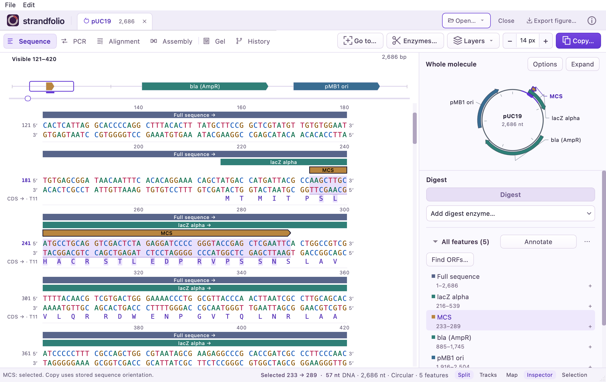
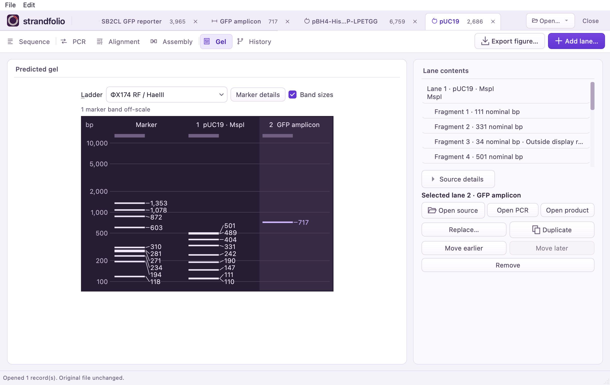
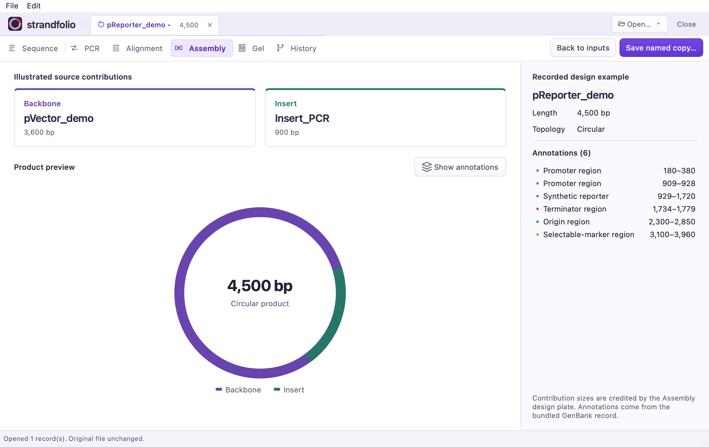
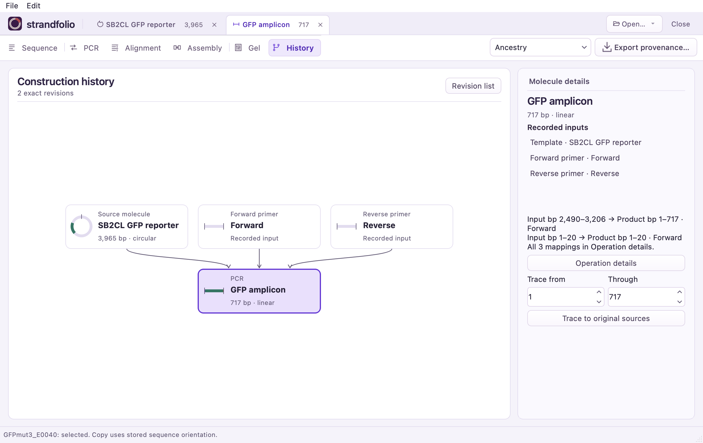
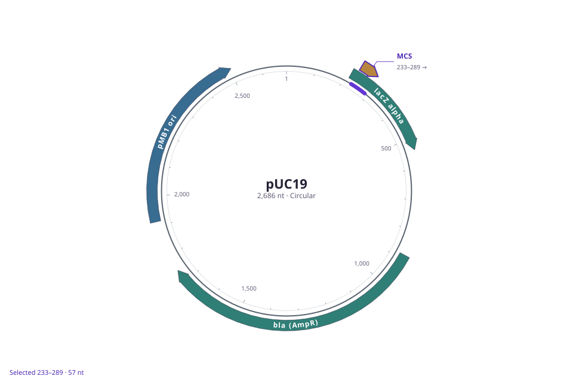

# Strandfolio

DNA cloning software for exploring annotated sequences in a desktop workspace. Select a feature on a plasmid map to see its bases, inspect a predicted gel band, or trace a PCR product back to its template and primers.

**[Download Strandfolio 0.1.12 for Mac (Apple Silicon, 62.8 MB)](https://github.com/luisub/strandfolio/raw/refs/heads/main/docs/releases/Strandfolio-0.1.12-macOS-arm64.dmg)**

Requires an Apple Silicon Mac running macOS 26.0 or later. To upgrade, quit Strandfolio and back up your project folders. Open the DMG and drag Strandfolio into **Applications**. Choose **Replace** if Finder asks. Eject the disk image, then open **Applications → Strandfolio**. If macOS blocks the first launch, follow the [steps in Troubleshooting](#troubleshooting).

Version 0.1.12 displays and copies only physical bases from known sticky-end strands, improves GenBank exchange and SnapGene import, and follows the selected PCR product in Gel. [File formats](docs/importing_sequences.md) · [Release notes](https://github.com/luisub/strandfolio/releases/tag/v0.1.12)

[Install and launch](#install-and-launch) · [Try pUC19](#try-puc19) · [Gallery](#workspace-gallery)

## Install and launch

- **Mac app** comes with Python and reference data. [Mac installation guide](docs/installation/README.md#install-the-mac-app)
- **Python package** installs with pip and runs from an activated environment. [PyPI installation guide](docs/installation/README.md#install-the-python-package-from-pypi)
- **Source checkout** includes the source, reference collections and notebooks. [Checkout installation guide](docs/installation/README.md#install-from-a-checkout)

## Try pUC19

1. Save the annotated [pUC19 GenBank file](databases/plasmids/maps/pUC19.gb) and open it in Strandfolio.
2. In **Sequence**, select **MCS** in the feature list. The map highlights the multiple cloning site, and the sequence view shows its 57 bases at positions 233–289.
3. Choose **Expand** to inspect the circular map. Choose **Back to tracks** to return to the bases.

To preview a digest, choose an enzyme from **Add digest enzyme…** in the Sequence sidebar and click **Digest**. You can inspect the fragments immediately and use **Save digestion…** if you want to keep the result.

## Workspace gallery

| Restriction digest | PCR |
| --- | --- |
|  |  |
| Inspect predicted fragments, their ends and their positions on the source sequence. | Test an existing primer pair, inspect the predicted amplicon, and review possible hairpins and primer dimers. |

| Alignment | Gel |
| --- | --- |
|  |  |
| Compare DNA, RNA or protein sequences at their source coordinates. Align 3–9 sequences with Kalign and export aligned FASTA. | Compare predicted band sizes against a ladder and select a band to see its contributing fragments. [Gel previews and ladders](databases/ladders/README.md#supported-size-previews) |

| Assembly | History |
| --- | --- |
|  |  |
| Inspect junctions and source contributions in the bundled 4,500 bp reporter. Generating a new construct from your own assembly plan is in development. | Trace a saved product back to its inputs, reopen its source or export the recorded ancestry as JSON. |

[More screenshots and example maps](docs/images/README.md)

## Examples and exports

The checkout includes four annotated plasmids and a linear bacteriophage λ example. Open pUC19 for cloning landmarks, the SB2CL GFP reporter for PCR, or the larger GFP expression plasmid to explore a crowded map. [Plasmid collection](databases/plasmids/README.md) · [Linear examples](databases/README.md#linear-reference-examples)

Export maps, sequence tracks and gel previews as SVG or PNG. Save annotated DNA as GenBank or share sequence text as FASTA. [Supported file formats](docs/importing_sequences.md#supported-inputs-and-fidelity)

## User guides

- [File formats & project exchange](docs/importing_sequences.md) — import GenBank, FASTA, text and SnapGene files, export constructs, and save portable projects.
- [Python notebooks](docs/notebooks/README.md) — reproduce sequence maps, explore ladder profiles and work with annotations in Python.

## Contributing

For a bug report, include your operating system, the steps to reproduce it and what you expected to see. If a bundled example reproduces the issue, name the record and the selected feature. Contributions to the code, examples and documentation are welcome. [Open an issue](https://github.com/luisub/strandfolio/issues/new) · [Pull requests](https://github.com/luisub/strandfolio/pulls)

## License

Copyright © 2026 Luis Aguilera. Original Strandfolio code is available under the BSD 3-Clause License. Third-party libraries and datasets retain their own terms. [License](LICENSE) · [Data notices](docs/installation/DATA-NOTICES.md)

## Troubleshooting

### macOS blocks Strandfolio on first launch

1. In Finder, open **Applications** and double-click **Strandfolio**. If macOS says it can’t verify the developer or check the app for malicious software, choose **Done** or **Cancel**. That alert can also offer **Move to Trash**.
2. Open **System Settings → Privacy & Security** and scroll to **Security**. If you downloaded Strandfolio from this repository and trust the copy, click **Open Anyway** beside the message about Strandfolio.
3. Click **Open** in the confirmation dialog. On future launches, open Strandfolio normally from Applications. [Apple’s first-open guide](https://support.apple.com/en-us/102445)

If the alert says Strandfolio is damaged or will damage your Mac, stop and report the exact wording and version. [Apple’s macOS alert guide](https://support.apple.com/en-us/102445)
